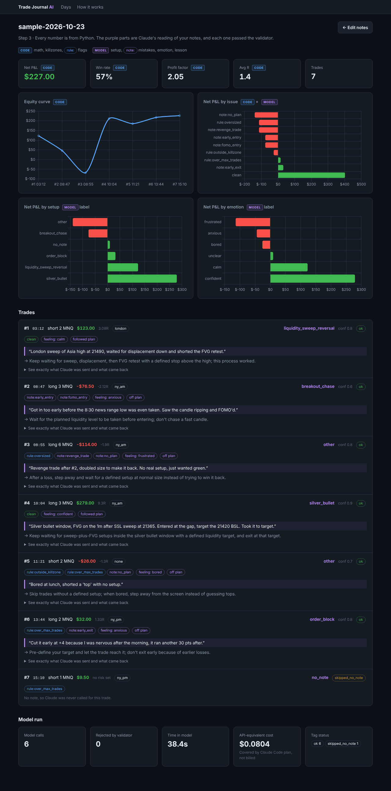

# trade-journal-ai

A futures trade journal where **Claude reads my trade notes and labels them**, and plain Python does everything else.

I trade MNQ/MES with ICT concepts on Vest Markets, using the TradeSea platform. The numbers from my TradeSea export (P&L, win rate) are easy to get. The part that actually matters is what I wrote right after each trade ("FOMO'd", "revenge trade", "cut it early because I was nervous"), and that part was never in my stats. This pipeline turns those notes into structured tags so I can see, for example, that my `note:fomo_entry` trades lose money and my `clean` trades don't.

TCSS 490, Artifact 3: *a system where a model does some of the work every time it runs.*

## Run the web app (easiest way to see it)

```bash
pip install -r requirements.txt     # just Flask
python app.py                       # → open http://127.0.0.1:5050
```



1. **Days**: import a TradeSea orders/fills CSV (or a Tradovate Performance CSV), or click **Load sample day**.
2. **Notes**: each trade shows what code computed (`CODE`: P&L, killzone, `rule:` flags). You type a note and your $ risk (`YOU`).
3. **Save & tag with Claude**: a progress bar shows each `claude -p` call (about 6 s per trade). Tick **Mock** to skip Claude.
4. **Report**: stat tiles, an equity curve, P&L by issue / setup / emotion, and a card for each trade with Claude's labels (`MODEL`). The labels include the exact quote from your note it used as evidence. Each card has a **"See exactly what Claude was sent and what came back"** section that shows the prompt, the validated JSON, each attempt, the time taken and the cost.
5. **How it works**: the whole pipeline on one page, including what the validator allows.

The web app is only a front end. `app.py` calls the same `tj/pipeline.py` functions as the CLI, so the model's job doesn't change. Everything stays on your machine: notes in `notes/`, uploads in `data/`, results in `out/` (all gitignored). Chart.js is bundled in `static/vendor/`, so it works offline (except the Claude call itself).

## How it runs

```
TradeSea fills CSV  (or Tradovate Performance CSV)
        │
        ▼
python journal.py template <csv>     ← code: parse, sort, number trades, killzones
        │
        ▼
notes/<day>.notes.csv                ← me: fill in `note` and `risk_usd`
        │
        ▼
python journal.py run <notes.csv>
   ├─ code: re-derive every number from the CSV, R-multiples, rule flags
   ├─ MODEL: claude -p, once per trade with a note → JSON label
   ├─ code: validate → retry once with errors → else UNTAGGED
   ├─ code: cache valid labels (re-runs make 0 model calls)
   └─ code: stats by setup / killzone / issue / emotion → out/<day>.report.md
```

`claude -p` runs headless with `--tools ""` (the model can't read files or run commands), a fixed system prompt and `--no-session-persistence`. It uses my Claude Code login, **not** a paid API key.

## What the model is responsible for, and what code checks

| | Who | Why |
|---|---|---|
| Parsing the CSV, pairing fills into trades, long/short, P&L after commission | **Code** (`tj/parse.py`, `tj/parse_fills.py`) | Exact arithmetic. A model could get it wrong and I'd never notice. |
| Killzone, R-multiple, hold time | **Code** (`tj/facts.py`) | It's just the clock and division. |
| Rule breaks: outside killzone, oversized, over max trades/day, past daily loss limit | **Code** (`tj/facts.py`, limits in `tj/rules.py`) | These can be proven from the numbers, so the model isn't allowed to tag them (they aren't in its allowed list). |
| **Setup** (sweep reversal, FVG, silver bullet, OB…) | **Model** | Only my free-text note says what I saw. |
| **Behavioural mistakes** (FOMO, revenge, moved stop, early exit…) | **Model** | Same reason: these come from what I wrote. |
| **Emotion, followed_plan, one-line lesson** | **Model** | Reading tone and summarizing is what the model is good at. |
| Every model field | **Code checks** (`tj/schema.py`) | Values must come from fixed lists. `confidence` must be 0–1. The lesson must be ≤140 chars. There can be no extra keys. **`evidence` must be an exact quote from my note**, so a label can't rest on something I never wrote. |
| Stats, grouping, report | **Code** (`tj/report.py`) | The model never does math. |

If something in the report is wrong, the `rule:` / `note:` prefix tells me who to blame: `rule:` comes from code, `note:` comes from the model.

## Quick start

```bash
# CLI version. Needs Python 3.10+ and Claude Code installed + logged in (`claude` on PATH). No pip installs.
python journal.py template sample/tradesea_2026-10-23.csv --out /tmp/try.notes.csv
python journal.py run sample/2026-10-23.notes.csv          # real Claude, ~6 s per trade
python journal.py run sample/2026-10-23.notes.csv --mock   # keyword stand-in, no Claude
python -m unittest discover tests                           # 25 tests, no Claude calls
```

For your own trades: in TradeSea, open Orders / Trade History and export a CSV (it needs Time, Symbol, Qty, Side, Avg Price; Commission and Status are used if present). Then run `template`, fill in the notes, then `run`. A Tradovate Performance CSV also works; the file type is detected from its headers.

**TradeSea exports list fills, not trades.** `tj/parse_fills.py` does the following:
- skips anything not `Filled`
- pairs fills into flat-to-flat round trips per contract (FIFO; handles scale-ins, scale-outs and position flips)
- computes P&L as points × $/point × contracts − commission (`POINT_VALUE` in `tj/rules.py`)
- converts fill times from Pacific (`FILLS_TZ`) to New York for killzones
Edit `tj/rules.py` to set your own killzones and risk limits.

Example output: [`sample/example-report.md`](sample/example-report.md)

## Cost, latency, reliability

These are measured on the sample day (6 notes): about 6.4 s per model call, 0 validator rejections, and an API-equivalent cost of about $0.003 per trade. Claude Code reports that figure, but the plan covers it. A cached re-run makes no model calls and takes 0.08 s. Labels stayed the same across two runs. `confidence` moved by ±0.1. See [`LOG.md`](LOG.md).

## Files

- `app.py` + `templates/` + `static/`: local web UI (Flask)
- `journal.py`: CLI
- `tj/pipeline.py`: the two steps (CSV → notes file, notes → tags + report), shared by the CLI and the web app
- `tj/tagger.py`: **the only file that calls a model**. It holds the prompt, the `claude -p` call, JSON extraction, retry, cache and the mock
- `tj/schema.py`: the model's output contract and validator
- `tj/parse.py`, `tj/facts.py`, `tj/rules.py`, `tj/report.py`: plain code
- `LOG.md`: plan and change log
- `CLAUDE.md`: instructions for Claude Code when working in this repo

*The sample data is made up for the demo. It's not real account history.*
